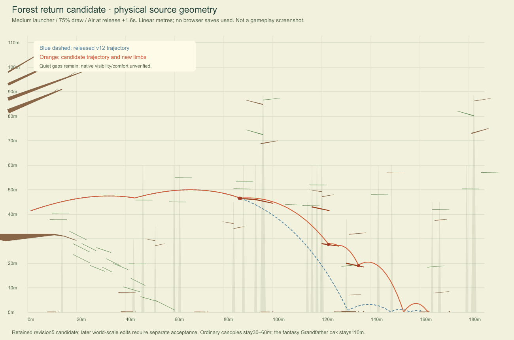

> Historical revision4→5 study. Current integration and limitations: [October 22 report](integration-2026-10-22.md). The 74 m integration failure described below was subsequently corrected and retained as a regression fixture.

# Bounded forest return candidate

This is a tested **revision4→5 candidate**, not a new public release or completion of the one-second encounter target. The last verified public release remains12, GitHub `28e4f3aea7adcc6e526237cb2c322839cc78d008`. Concurrent local work now changes the oak to74m and introduces four world zones. Its revision6 inherits these five limbs, but requires separate integrated acceptance. Those unrelated edits have been preserved. A subsequent stable-source36-case integration check found a release blocker: all9 Elephant cases have pre-release contacts with `oak-scaffold-0-west` and report `Beam overloaded`. The new74m oak compression moves that scaffold into the gantry sweep.27 other cases finish without those failures; a `finished` phase alone does not establish a successful launch. Correct the visible scaffold placement/clearance in the new world before publishing; do not hide the problem with collision immunity or a substituted launch.

## Cause and regional diagnosis

The released36-case census contains **202 forest quiet intervals over1s**, including terminal support, plus3 intentional open-sky intervals. Final calm support is labeled, not silently removed;190 forest intervals still exceed1s after its subtraction. The [complete manifest](released-v12-gap-census.json), [CSV](released-v12-gap-census.csv) and [regional report](released-v12-corridors.md) identify coordinates, worldY/altitude, direction, animal/build/weapon, apex, nearby real geometry/species and measured compound-fixture clearances for every interval. These are frozen release12 measurements.

The worst Medium75%Air route travels x−0.52→130.61m, H40.82→0.72m with an apex at x66.37/H49.99. It clears one existing bough by0.587m and passes2.690m below another, then descends below the higher116/120m forks. This is a missing landing band, not a missing-object counter or open-sky classification issue.

## Authored correction

Five visible passive limbs attach to existing93/116/120/130m trunks. They use the established7m branch reach and22→10cm taper; tree heights, species sizes, launcher geometry, launch momentum and encounter powers are unchanged. The route moves from H46.5 to18.5m. Removing the opposing west faces at116/120m leaves recovery openings rather than narrow roofs/slots for large bodies. The canonical editor/runtime both receive the same polygons. Exact untouched revision4 defaults migrate in memory; startup never writes saved map bytes, and custom/named/edited maps remain authoritative.

[Source-geometry comparison](images/forest-return-candidate.png) (not a gameplay screenshot):

## Controlled comparisons

The [84-case report](forest-return-comparison.json) uses real finite-force Enter loading, observed support, powered winding and actual release at1/120s. It includes the released36 cases and48 additional draw/weapon combinations. Both sets informed the final design; these are not independent blinded tests or continuous launch certification. Air fires at release+1.6s; Staff/Slingshot at+1.6,+2.3,+3.0s.

| Build/draw/action | Longest forest gap before→after | Range before→after |
|---|---:|---:|
| Medium75%Air |6.22→3.34s |161.04→164.15m |
| Medium full/natural |3.03→2.53s |135.05→135.05m |
| Medium87.5%Slingshot |5.65→5.00s |135.62→172.83m |
| Bear50%Slingshot |4.51→2.87s |117.56→117.56m |
| Bear62.5%natural |5.50→3.70s |130.70→165.13m |
| Elephant80%natural |4.82→4.82s |223.48→186.22m |

The Elephant loss of16.7% is a material tradeoff, not an improvement. All84 tested cases finish without new pre-release contacts or failures, without a forest/whole-flight gap increase over0.05s and retaining at least80% of prior maximumX. MaximumX is the established progress metric, not final restingX.

Medium75%Air now reaches three distinct upward passive contacts. Its11.21→13.49s flight contains additional active rebounds: time since the final speed>3m/s sample decreases1.77→1.34s. This source diagnostic is not the runtime settling rule. Across all84, that terminal slow tail increases by at most0.52s; the guard allows0.75s. The longest original36-case forest gap is still6.13s (Medium75%Slingshot). Most starter and high-airway paths remain unchanged. Density acceptance is **open**.

## Rejected batches and next work

- Broad early canopy crests shortened one gap but trapped/reversed Bear and collapsed Medium progress.
- A proportionate45m opening tree plus low forks reduced a minimum-draw Medium run to29% of its previous range. Rejected.
- The original eight-limb return passed36 cases but additional draws exposed Bear62.5%Slingshot range314→167m and gap3.72→4.45s, plus an extra5s Bear87.5%Air aftermath. Rejected; the five-face variant removes those offending opposing faces.
- Two existing canonical2.4m crown clouds reduced full-Elephant range to56% and worsened a Slingshot gap. Rejected; no clouds, tiny birds, invisible walls or added powers enter this candidate.

Next highest-value design work is a coherent ordinary-to-rare canopy seam at x70–145/H55–67, followed by the opening x20–70m bounce region and slow/reversing middle-canopy pockets. High-airway Elephant75%Staff still travels x9→239/H85→107→83 without useful intermediate contact; it is inside the conservative forest band but above nearby88.5m trees. Taller trees are not a valid fix. Any aerial route needs readable existing-scale interactors and a measured continuation, rather than a wall or isolated coordinate hit. Rebase this plan on the concurrent74m/four-zone world before adding further geometry.

## Verification and integration boundary

The initial mixed working-tree run failed during concurrent editor/ruler/altitude/world edits; it is not this candidate's acceptance. The candidate is also retained in `/tmp/treetop-return-validation`, reconstructed from release12 plus only this return, its migration, cache changes and regressions. The final isolated full suite passes **957/957** (`/tmp/critz-v13-isolated-final-tests.log`). Pinned Planck1.5.1 byte comparison and source syntax/whitespace checks pass. The census generator was rerun from frozen dense traces and reproduced all202 forest intervals,3 sky intervals and identical interval records. These results validate the isolated revision5 candidate, not the concurrently edited revision6 world. No new GitHub commit, push, Site version or deployment has been made in this pass.

Native desktop/phone readability, camera comfort, input and editor acceptance remain unverified: supported browser/computer controls are absent. Source geometry and tests do not replace that evidence. No browser state, personal save, user map, tabs or unrelated repository has been modified. The user's preview server is left running.
